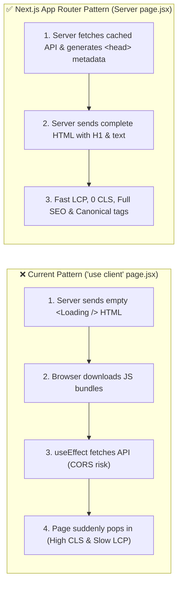

# Production Audit Correlation, Step-by-Step Fixing Plan & Developer Learning Guide

> **Based on:** Production Playwright + Lighthouse Audit Report (`serv5.com.eg`, 100 Pages Inspected) + Static & Local Codebase Audit (`src/app/`, `src/domains/`, `src/lib/`, `src/proxy.js`).

---

## Table of Contents

1. [Master Correlation Table: All 13 Production PDF Issues + 5 Extra Code-Level Audit Issues](#1-master-correlation-table-all-13-production-pdf-issues--5-extra-code-level-audit-issues)
   - [1A. All 13 Production PDF Issues Mapped to Exact Code Lines](#1a-all-13-production-pdf-issues-mapped-to-exact-code-lines)
   - [1B. The 5 Additional Code-Level Issues from `FRONTEND_AUDIT.md`](#1b-the-5-additional-code-level-issues-from-frontend_auditmd)
2. [3-Day Master Execution Schedule (Hour-by-Hour Checklist)](#2-3-day-master-execution-schedule-hour-by-hour-checklist)
3. [Step-by-Step Fixing Guide (Ordered across the 3 Days)](#3-step-by-step-fixing-guide-ordered-across-the-3-days)
   - [Day 1 Steps: Quick Wins — Eliminate `307` Redirects, Fix All 100-Page A11y Errors, Sitemaps, Root Locale & Blog/Portfolio `TTFB`](#day-1-steps-quick-wins--eliminate-307-redirects-fix-all-100-page-a11y-errors-sitemaps-root-locale--blogportfolio-ttfb)
   - [Day 2 Steps: Core Web Vitals (`CLS` & `LCP`) & Server-Side Rendering + Canonical SEO on 93 Pages](#day-2-steps-core-web-vitals-cls--lcp--server-side-rendering--canonical-seo-on-93-pages)
   - [Day 3 Steps: Main-Thread Work (`TBT`), Heavy Homepage Payload (`3.7 MB`), Image Dimensions & Fonts](#day-3-steps-main-thread-work-tbt-heavy-homepage-payload-37-mb-image-dimensions--fonts)
4. [Concepts & Learning Guide: What You Need to Learn to Master These Fixes](#4-concepts--learning-guide-what-you-need-to-learn-to-master-these-fixes)

---

## 1. Master Correlation Table: All 13 Production PDF Issues + 5 Extra Code-Level Audit Issues

### 1A. All 13 Production PDF Issues Mapped to Exact Code Lines

Every single metric in your 9-page PDF report traces directly to specific files and lines in your Next.js codebase:

| PDF # | Production Issue (from PDF) | Measured Impact in PDF | Exact Root Cause in Your Frontend Code |
| :---: | :--- | :--- | :--- |
| **1** | **Layout Shift (`CLS`)** | `> 0.1` on 93/100 pages (`0.255` on `/en`, `0.835` on `/about-us`, `1.52` on mobile services/blog) | **1)** 12 route `page.jsx` files (`src/app/about-us/page.jsx:43`, `src/app/services/[slug]/page.jsx:103`, `src/app/blog/page.jsx:42`, etc.) render `<Loading />` on SSR and then replace the entire page DOM after client `useEffect` finishes, violently shifting `<Footer />`.<br>**2)** 29 raw `` tags on `/en` (`Hero.jsx:110`, `Earth.jsx:126`, `Features.jsx:263`, `Services.jsx:310`, `Footer.jsx:70`) lack `width` and `height` attributes. |
| **2** | **Slow `LCP` (Largest Contentful Paint)** | `> 2.5s` on 57 desktop & 79 mobile pages (`3.9s` on `/en`, `10.25s` on `/en/services/services-seo-optimization`) | **1)** Service, Blog, About, Portfolio, and FAQ pages are `"use client"` components that do not even start fetching their hero text/image until JS bundles download, hydrate, and execute `useEffect`.<br>**2)** Hero images in `Hero.jsx:110`, `Earth.jsx:126`, and `ServicesHero.jsx:182` use raw `` tags instead of `next/image` with `priority`.<br>**3)** `src/app/layout.js:228` wraps the entire app in `<Suspense fallback={<Loading />}>` while `ProvidersAndContent` awaits 3 uncached/semi-cached API calls. |
| **3** | **`307` Redirects on Internal Links** | `11` requests in DevTools (`146ms–236ms` latency each) | In `src/domains/Shared/Footer/Footer.jsx:162, 181, 198, 217`, `<Link href={safeUrl(link.url)}>` renders the **11 footer links without the `/${language}` prefix** (e.g., `/about-us`, `/blog`, `/portfolio`). When Next.js prefetches those 11 `<Link>`s in the viewport, `src/proxy.js:153` intercepts them and returns a `307 Temporary Redirect` to `/en/...`! (Also happens in `portfolio/[id]/page.jsx:75, 108` and `LatestBlogs.jsx:90`). |
| **4** | **Elements Without Accessible Names (a11y)** | Links on **100 pages** (`5` per page, `17` on `/about-us`, `10` on `/contact-us`), Form fields on **30 pages**, Buttons on **5 pages** | **1) Links (`5` on all 100 pages):** The 5 social media icon links in `src/domains/Shared/Footer/Footer.jsx:312-321` have no `aria-label`! On `/about-us`, 5 footer links + 12 team social links (`src/domains/AboutUs/TeamWork.jsx:420-449`) = **17 links**. On `/contact-us`, 5 footer links + 5 social links (`src/domains/Contact/ContactInfo.jsx:289-298`) = **10 links**.<br>**2) Form fields:** Inputs in `ContactUs.jsx:220-403`, `ContactForm.jsx:164-415`, `QuotationForm.jsx:748`, `ConsultationForm.jsx:411`, `careers/page.jsx:232, 531`, and `Newsletter.jsx:74` lack `<label htmlFor>` or `aria-label`.<br>**3) Buttons:** Icon-only buttons in `Hero.jsx:197`, `Features.jsx:422, 497`, `Navbar.jsx:584, 654`, and `ContactUs.jsx:251` lack `aria-label`. |
| **5** | **Scrollable Region Not Keyboard Accessible** | **4 pages** (e.g., `/en/services/services-web-hosting`) | In `src/domains/Services/Services-web-hosting/ServicesHero.jsx:138` (and `EcommerceHero.jsx:141`, `MobileAppsHero.jsx:141`, `SocialMediaHero.jsx:139`, `WebDesignHero.jsx:106`, `WebDevHero.jsx:112`), the hero `<motion.p>` has `max-h-[30vh] overflow-y-auto`. When long description text overflows `30vh`, it creates a scrollable container with no focusable child and no `tabIndex={0}`. |
| **6** | **Heavy Homepage (`Heavy page`)** | `3.7 MB` (`6,696 KiB`), `88 Requests` on `/en` | **1)** `HomePageClient.jsx:76-90` fires **11 API requests** on mount.<br>**2)** 29 raw `` tags + `<Image fill>` without `sizes` downloading full-resolution images (`2,104 KiB` savings).<br>**3)** 91 KB `translations.js` bundled in root client chunk + 4 font families (`Montserrat`, `Poppins`, `Alexandria`, `TsDamasSans`) + both `gsap` and `framer-motion`. |
| **7** | **Slow `TTFB` on Blog & Portfolio** | `875ms–2,350ms` across 45 pages vs `302ms` on other pages | **1)** `src/app/blog/[id]/layout.jsx:20` and `src/app/portfolio/[id]/layout.jsx:20` call `fetchAPI(...)` directly inside `generateMetadata()`. Because `fetchAPI` in `src/lib/api.js:179` defaults to `cache: "no-store"`, Next.js blocks server response on an uncached backend API call on every visit (even though `getCachedBlogPost` already exists in `src/lib/cached-api.js:42`, it is never used!).<br>**2)** `src/app/layout.js:124-125` calls `fetchAPI('/services')` and `fetchAPI('/nav-links')` with `cache: "no-store"` on every request. |
| **8** | **Missing `canonical` (42 pages), Missing `H1` (4 pages), Duplicate `H1` (3 pages)** | 42 pages without `canonical`; 4 pages without `<h1>`; `blog/1020` has 10 `<h1>` tags | **1) Missing `canonical`:** 12 `"use client"` route pages lack `generateMetadata` + `(home)/page.jsx:10` omits `getSeoAlternates()` + `[slug]/page.jsx:9` overwrites `[slug]/layout.jsx` without `alternates`.<br>**2) Missing `H1`:** `src/domains/Blog/BlogHero.jsx:44` uses `<motion.h2>` instead of `<motion.h1>`; `contact-us` and `portfolio/[id]` render `<Loading />` (no `<h1>`) during SSR or when API times out.<br>**3) Duplicate `H1` (10 `<h1>`s in `blog/1020`):** `src/lib/sanitize-html.js:12` allows `<h1>` inside rich-text blog HTML (`post.content`), which renders alongside the main `<h1>{post.title}</h1>` in `src/app/blog/[id]/page.jsx:192`. |
| **9** | **Broken External Link (`http://serv5.eg`)** | 1 link in `/blog/1065` fails with `ENOTFOUND` | Typo inside the CMS HTML content of blog post `1065` (`http://serv5.eg` instead of `https://serv5.com.eg`). Can be fixed in the CMS and auto-corrected in `src/lib/sanitize-html.js`. |
| **10** | **High Main-Thread Work & Heavy JS (`TBT`)** | `TBT: 830ms` (`/en`) & `1,060ms` (`/about-us`); `21.1s` main-thread work | **1)** `src/domains/Home/Features/Features.jsx:131-154` runs `setInterval(..., 30)` reading/writing `el.scrollLeft` 33 times/sec (forced synchronous reflows).<br>**2)** `src/domains/Home/OnlineWebsite/OnlineWebsite.jsx:204-212` runs 40 simultaneous Framer Motion JS particle loops.<br>**3)** `LanguageContext.jsx:38-58` re-fetches `/settings` on mount with an un-memoized `value`, triggering a full-tree React re-render across the entire page. |
| **11** | **Image Delivery & Missing `width`/`height`** | `2,104 KiB` savings on `/en`; missing explicit `width` & `height` | **1)** Raw `` tags in `Navbar.jsx`, `Hero.jsx`, `Earth.jsx`, `Features.jsx`, `Services.jsx`, `Testimonial.jsx`, `Footer.jsx`, and `blog/1060`–`1061` lack `width`/`height` and `next/image` compression.<br>**2)** 18+ `<Image fill>` usages (`PortfolioGallery.jsx`, `BlogGrid.jsx`, `BlogHero.jsx`, `AboutHero.jsx`, `OurJourney.jsx`) omit the `sizes` prop, downloading 3840px (`100vw`) images for small cards/icons. |
| **12** | **Broken Heading Hierarchy (`Heading Order`)** | High severity in Lighthouse Accessibility | **1)** `src/domains/Shared/Footer/Footer.jsx:82, 156-230` jumps from `<h2>` directly to `<h4>` (skipping `<h3>`) on **all 100 pages**.<br>**2)** `Testimonial.jsx:113, 274` (`h2` → `h4`), `AboutHero.jsx:47, 68` (`h1` → `h3`), `PortfolioGallery.jsx:270, 84` (`h1` → `h3`), `FAQContent.jsx:110, 248` (`h1` → `h3`), `WebDevHowWeWork.jsx:110, 118` (`h3` before `h2`). |
| **13** | **`401` on `/api/v1/me` & `403`/`999` on External Social Links** | `198` `401` responses on `/api/v1/me` | `src/app/context/AuthContext.jsx:13` calls `fetchAPI("/me")` unconditionally on every page load even when no user has ever logged in. |

---

### 1B. The 5 Additional Code-Level Issues from `FRONTEND_AUDIT.md`

These 5 code-level issues were uncovered in the static & local audit (`FRONTEND_AUDIT.md`) and were not directly flagged by the automated Playwright/Lighthouse summary, but are essential for complete SEO, Performance, and Accessibility compliance:

| Audit # | Code-Level Issue (from `FRONTEND_AUDIT.md`) | Impact on Production | Exact Root Cause in Your Frontend Code |
| :---: | :--- | :--- | :--- |
| **E1** | **Missing `/sitemap.xml` Index (`404`) & Un-prefixed Sitemap URLs** | Google Search Console cannot discover the master `/sitemap.xml`, and sub-sitemaps return `307` redirecting URLs | **1)** `src/app/sitemap.js.bak` is disabled with a `.bak` extension.<br>**2)** `src/app/post-sitemap.xml/route.js:16`, `page-sitemap.xml/route.js`, `service-sitemap.xml/route.js`, and `portfolio-sitemap.xml/route.js` emit URLs without `/ar` or `/en` prefixes (e.g. `https://serv5.com.eg/blog/1020`), which trigger `307` redirects in `src/proxy.js`. |
| **E2** | **`robots.txt` Blocks `/portfolio` & `/_next/`** | Prevents Googlebot from indexing `/portfolio` pages and blocks CSS/JS rendering assets | `src/app/robots.js:20-34` lists `disallow: ["/portfolio", "/_next/", "/_next/static/", "/_next/image/", ...]` even though `portfolio-sitemap.xml` submits `/portfolio` URLs to Google. |
| **E3** | **Hardcoded `<html lang="ar" dir="rtl">` in Root SSR HTML** | Search crawlers and screen readers see `lang="ar" dir="rtl"` on `/en/*` English pages before JS hydration | `src/app/layout.js:162` hardcodes `<html lang="ar" dir="rtl">` instead of reading the `x-locale` request header set by `src/proxy.js:160`. |
| **E4** | **Render-Blocking External Font CSS (`@import` & CDN `<link>`)** | Delays First Contentful Paint (`FCP`) and `LCP` on every initial page load | **1)** `src/app/globals.css:1` has `@import url('https://fonts.googleapis.com/css2?family=Alexandria...');` which forces a synchronous CSS network waterfall.<br>**2)** `src/app/layout.js:168` loads `https://fonts.cdnfonts.com/css/somar` via a render-blocking `<link rel="stylesheet">`. |
| **E5** | **Additional A11y Polish (Duplicate `id`s, FAQ `aria-expanded`, Contrast)** | Breaks screen reader accordion state announcements and ARIA `id` uniqueness | **1)** `src/domains/Shared/Navbar/Navbar.jsx:121` renders duplicate `id`s in desktop + mobile DOM trees.<br>**2)** `src/domains/FAQ/FAQContent.jsx:96-103` accordion buttons lack `aria-expanded={isOpen}`.<br>**3)** `src/domains/Shared/Footer/Footer.jsx:140` uses low-contrast `text-gray-400` on light/translucent backgrounds. |

---

## 2. 3-Day Master Execution Schedule (Hour-by-Hour Checklist)

All **13 PDF report issues + 5 extra code-level audit issues** can be completed in **3 focused days (~18–21 hours total)** because shared layout/navigation components (`Footer.jsx`, `Navbar.jsx`, `layout.js`, `AuthContext.jsx`) and a single repeated route pattern (`"use client"` + `<Loading />`) account for over 90% of the errors across all 100 URLs.

### Day 1 (~6.5 Hours): Shared Components, A11y, Technical SEO, Sitemaps & Fast `TTFB`
*Resolves ~65% of the warnings across all 100 pages on the very first day.*

- [ ] **Hour 1 — Kill All `307` Redirects & `401` Console Errors (`PDF #3`, `PDF #13`):**
  - Update `src/domains/Shared/Footer/Footer.jsx` with `getLocalizedHref` (Step 1.1).
  - Guard `/api/v1/me` in `src/app/context/AuthContext.jsx` (Step 1.5).
- [ ] **Hours 2–3.5 — Fix All 100-Page Accessibility (`a11y`) Failures (`PDF #4`, `PDF #5`, `PDF #12`, `Extra E5`):**
  - Add `aria-label` to social links in `Footer.jsx`, `TeamWork.jsx`, `team-work/page.jsx`, `ContactInfo.jsx`, and `ContactModal.jsx` (Steps 1.1 & 1.2).
  - Add `title` to the Google Maps `<iframe>` in `ContactMap.jsx` (Step 1.2).
  - Fix scrollable hero regions (`tabIndex={0}` or remove `max-h-[30vh] overflow-y-auto`) in the 6 `Services*Hero.jsx` files (Step 1.3).
  - Fix heading hierarchy jumps (`h2` → `h3`) in `Footer.jsx`, `Testimonial.jsx`, `AboutHero.jsx`, `PortfolioGallery.jsx`, `FAQContent.jsx`, and `careers/page.jsx` (Steps 1.1 & 1.8).
  - Add `<label htmlFor>` / `aria-label` to form inputs (`ContactForm.jsx`, `ConsultationForm.jsx`, `QuotationForm.jsx`, `ContactUs.jsx`, `Newsletter.jsx`), add `aria-expanded` to `FAQContent.jsx`, and remove duplicate `id`s in `Navbar.jsx` (Step 1.8).
- [ ] **Hours 3.5–5 — Fix Root SSR `lang`/`dir`, `robots.txt`, Sitemaps & Blog H1s (`PDF #8`, `PDF #9`, `Extra E1`, `Extra E2`, `Extra E3`):**
  - Read `x-locale` header in `src/app/layout.js` for dynamic `<html lang={locale} dir={dir}>` (Step 1.6).
  - Fix `src/app/robots.js` (allow `/portfolio` and `/_next/`) and restore `/sitemap.xml` with `/ar` and `/en` URLs (Step 1.6).
  - Change `<motion.h2>` to `<motion.h1>` in `BlogHero.jsx` and downgrade rich-text `<h1>` → `<h2>` + fix `serv5.eg` in `src/lib/sanitize-html.js` (Step 1.4 & Step 2.2).
- [ ] **Hours 5–6.5 — Fix Slow `TTFB` on Blog, Portfolio & Root Layout (`PDF #7`):**
  - Add `getCachedPortfolioItem`, `getCachedServicesList`, and `getCachedNavLinks` in `src/lib/cached-api.js` and wire them into `blog/[id]/layout.jsx`, `portfolio/[id]/layout.jsx`, and `src/app/layout.js` (Step 1.7).

---

### Day 2 (~7.5 Hours): SSR Conversion — Fixing `CLS`, `LCP` & Missing Canonicals on 93 Pages
*Eliminates the `<Loading />` layout shift (`CLS 0.835` → `< 0.05`), cuts `LCP` (`10.25s` → `< 2.0s`), and restores `<link rel="canonical">` on all 42 missing pages.*

- [ ] **Hour 1 — Stop Homepage Client Double-Fetching (`PDF #6`):**
  - Update `src/app/(home)/HomePageClient.jsx` to remove `{ ssr: false }` and skip the 9-endpoint `useEffect` refetch on initial mount when `initialData` already matches `language` (Step 2.3).
- [ ] **Hours 2–7.5 — Convert the 12 Client-Only `page.jsx` Routes to Server Components + `*Client.jsx` (`PDF #1`, `PDF #2`, `PDF #8`):**
  - Apply the Server Component + `generateMetadata` (`getSeoAlternates()`) pattern (Step 2.1) to:
    - **Batch A (Hours 2–4):** `about-us/page.jsx`, `services/page.jsx`, `services/[slug]/page.jsx`, `[slug]/page.jsx`.
    - **Batch B (Hours 4–6):** `blog/page.jsx`, `blog/[id]/page.jsx`, `portfolio/page.jsx`, `portfolio/[id]/page.jsx`, `our-products/page.jsx`, `our-products/[id]/page.jsx`.
    - **Batch C (Hours 6–7.5):** `contact-us/page.jsx`, `faq/page.jsx`, `careers/page.jsx`, `team-work/page.jsx`, `project-consultation/page.jsx`, `request-quote/page.jsx`, `bank-accounts/page.jsx`.

---

### Day 3 (~6 Hours): Image Optimization, Main-Thread `TBT`, Fonts & Final Verification
*Pushes Lighthouse Performance & Accessibility scores to green and verifies all fixes in production mode.*

- [ ] **Hours 1–3 — Optimize Images & Add Missing Dimensions (`PDF #1`, `PDF #6`, `PDF #11`):**
  - Add explicit `width`/`height` or convert raw `` tags to `next/image` in `Hero.jsx`, `Earth.jsx`, `Navbar.jsx`, `Features.jsx`, `Services.jsx`, `HostingOffers.jsx`, `ServicesFeatures.jsx`, `LatestBlogs.jsx`, and `Testimonial.jsx` (Step 3.2).
  - Add `sizes` prop to all `<Image fill>` usages across cards and galleries (Step 3.2).
- [ ] **Hours 3–5 — Eliminate Main-Thread `TBT` (`1,060ms` → `< 200ms`) & Render-Blocking Fonts (`PDF #10`, `Extra E4`):**
  - Replace the `30ms` `setInterval` scroll loop in `Features.jsx` with a CSS `@keyframes` marquee (Step 3.1).
  - Reduce the 40 Framer Motion particle loops in `OnlineWebsite.jsx` (Step 3.1).
  - Memoize `LanguageContext.jsx` provider value with `useMemo` (Step 3.1).
  - Remove render-blocking `@import` in `src/app/globals.css` and migrate fonts to `next/font` in `src/app/layout.js` (Step 3.3).
- [ ] **Hour 5–6 — Production Build & Verification (`npm run build && npm run start`):**
  - Run Lighthouse & Playwright verification on `/en`, `/ar`, `/en/about-us`, `/en/services/services-web-hosting`, `/en/blog`, and `/en/contact-us`.

---

## 3. Step-by-Step Fixing Guide (Ordered across the 3 Days)

### Day 1 Steps: Quick Wins — Eliminate `307` Redirects, Fix All 100-Page A11y Errors, Sitemaps, Root Locale & Blog/Portfolio `TTFB`

These fixes require focused edits and immediately resolve **PDF Issues #3, #4, #5, #7, #8 (Duplicate H1 & iframe title), #9, #12, #13, and Extra Audit Issues E1, E2, E3, E5**.

#### Step 1.1: Fix the 11 Internal `307` Redirects + Missing Social `aria-label`s + `h2`→`h4` Heading Jump in `Footer.jsx`
- **File:** `src/domains/Shared/Footer/Footer.jsx`
- **What to change:**
  1. Add a `getLocalizedHref(url)` helper (just like `Navbar.jsx:37-49`) so all internal footer `<Link>`s and `router.push()` include `/${language}` (`/en/...` or `/ar/...`), eliminating all 11 `307` prefetch redirects!
  2. Change the five `<h4>` column headings (lines 156, 175, 194, 211, 230) to `<h3>` so headings follow `h2` → `h3`.
  3. Add `aria-label={social.platform}` to the social media `<motion.a>` links (lines 312–321), fixing the "5 unnamed links on all 100 pages" error!
  4. Set `alt=""` and `aria-hidden="true"` on the decorative `/Element.webp` image (line 72) and add `width={500} height={500}`.

```jsx
// Add inside Footer component in src/domains/Shared/Footer/Footer.jsx (after line 30):
const getLocalizedHref = (href) => {
  const safeHref = safeUrl(href);
  if (
    safeHref === "#" ||
    safeHref.startsWith("http") ||
    safeHref.startsWith("tel:") ||
    safeHref.startsWith("mailto:")
  ) {
    return safeHref;
  }
  const cleanHref = safeHref.startsWith("/") ? safeHref : `/${safeHref}`;
  const cleanNoLocale = cleanHref.replace(/^\/(ar|en)(\/|$)/, "/");
  if (cleanNoLocale === "" || cleanNoLocale === "/") return `/${language}`;
  return `/${language}${cleanNoLocale}`;
};
```
Then replace `href={safeUrl(link.url)}` on lines 163, 182, 199, and 218 with `href={getLocalizedHref(link.url)}`, replace `router.push("/contact-us")` on line 111 with `router.push(`/${language}/contact-us`)`, and add `aria-label={social.platform}` to `<motion.a>` on line 313.

#### Step 1.2: Fix the Remaining Unnamed Social Links on `/about-us` (`17` links) and `/contact-us` (`10` links) + Missing `iframe` Title
1. **`src/domains/AboutUs/TeamWork.jsx` (Lines 420–449) & `src/app/team-work/page.jsx` (Lines 387–416):**
   - Add `aria-label={`${member.name} LinkedIn`}`, `aria-label={`${member.name} GitHub`}`, and `aria-label={`${member.name} X`}` to the three `<a>` tags on each team card.
2. **`src/domains/Contact/ContactInfo.jsx` (Lines 289–298) & `src/domains/Shared/Components/ContactModal.jsx` (Lines 178–188):**
   - Add `aria-label={social.platform}` to the social `<a>` / `<motion.a>` tags.
3. **`src/domains/Contact/ContactMap.jsx` (Lines 105–113):**
   - Add `title={language === "ar" ? "موقع شركة سيرف فايف على الخريطة" : "Serv5 Location on Google Maps"}` to the `<iframe>` (fixes the `iframe بدون title` error on `/contact-us` from PDF Page 5!).

#### Step 1.3: Fix the Keyboard-Inaccessible Scrollable Regions (`PDF Issue #5`)
- **Files:**
  - `src/domains/Services/Services-web-hosting/ServicesHero.jsx:138`
  - `src/domains/Services/Services-ecommerce/EcommerceHero.jsx:141`
  - `src/domains/Services/Services-mobile-apps/MobileAppsHero.jsx:141`
  - `src/domains/Services/Services-social-media/SocialMediaHero.jsx:139`
  - `src/domains/Services/Services-web-design/WebDesignHero.jsx:106`
  - `src/domains/Services/Services-web-dev/WebDevHero.jsx:112`
- **What to change:** Either remove `max-h-[30vh] overflow-y-auto` so the hero paragraph displays naturally without an inner scrollbar, **or** add `tabIndex={0} role="region" aria-label={title || "Service Description"}` to the `<motion.p>` element so keyboard users can focus and scroll it with arrow keys.

#### Step 1.4: Fix Duplicate `<h1>`s Inside Blog Articles (`blog/1020`) & Broken `serv5.eg` Link (`blog/1065`) in `src/lib/sanitize-html.js`
- **File:** `src/lib/sanitize-html.js`
- **Why:** Blog articles crafted in the CMS sometimes contain `<h1>` tags inside `post.content` (causing 10 `<h1>` tags on `blog/1020`), images without `alt` attributes (`blog/1060`, `blog/1061`), or the typo `http://serv5.eg` (`blog/1065`).
- **What to change in `src/lib/sanitize-html.js` (`serializeNode` function):**
  1. Downgrade any `<h1>` inside rich-text article bodies to `<h2>` (`const tagName = rawTagName === "h1" ? "h2" : rawTagName;`) so only the main page title is `<h1>`.
  2. Ensure every `` inside rich-text HTML gets `alt=""` if `alt` is missing, plus `loading="lazy"`.
  3. Rewrite any `href` containing `serv5.eg` (without `.com`) to `https://serv5.com.eg`.

#### Step 1.5: Stop the 198 Unnecessary `401 /api/v1/me` Calls (`PDF Issue #13`)
- **File:** `src/app/context/AuthContext.jsx` (Lines 12–22)
- **What to change:** Only call `fetchAPI("/me")` on page load if `localStorage.getItem("serv5_has_session") === "1"` (set `"1"` on login/register and remove it on logout or 401). Anonymous visitors will no longer fire a failing `401` request on every page.

#### Step 1.6: Fix Root SSR `<html lang dir>`, `robots.txt` & Sitemaps (`Extra Audit Issues E1, E2, E3`)
1. **`src/app/layout.js` (Line 162 — `Extra E3`):**
   - Read the `x-locale` header already injected by `src/proxy.js:160` so `/en/*` pages render `<html lang="en" dir="ltr">` on initial server response:
   ```jsx
   import { headers } from "next/headers";
   // Inside RootLayout:
   const reqHeaders = await headers();
   const locale = reqHeaders.get("x-locale") === "en" ? "en" : "ar";
   const dir = locale === "ar" ? "rtl" : "ltr";
   return (
     <html lang={locale} dir={dir} suppressHydrationWarning>
   ```
2. **`src/app/robots.js` (Lines 20–34 — `Extra E2`):**
   - Remove `"/portfolio"`, `"/_next/"`, `"/_next/static/"`, and `"/_next/image/"` from the `disallow` array so Googlebot can crawl `/portfolio` and load page CSS/JS assets.
3. **`src/app/sitemap.xml/route.js` & `src/app/*-sitemap.xml/route.js` (`Extra E1`):**
   - Rename `src/app/sitemap.js.bak` (or create `src/app/sitemap.xml/route.js`) so `/sitemap.xml` returns a valid `<sitemapindex>` pointing to `page-sitemap.xml`, `service-sitemap.xml`, `post-sitemap.xml`, and `portfolio-sitemap.xml`.
   - In each `*-sitemap.xml/route.js` file, emit localized `/ar/...` and `/en/...` URLs instead of un-prefixed URLs so sitemap links return `200 OK` instead of `307 Temporary Redirect`.

#### Step 1.7: Cache Server Metadata & Layout Fetches (`TTFB` from `2.35s` → `< 0.4s` — `PDF Issue #7`)
1. **`src/lib/cached-api.js`:**
   - Add cached helpers for `/portfolio/${id}`, `/products/${id}`, `/services`, and `/nav-links`:
   ```js
   export const getCachedPortfolioItem = unstable_cache(
     async (id, locale = "en") =>
       fetchAPI(`/portfolio/${id}?lang=${locale}`, { skipHeaders: true }),
     ["portfolio-item"],
     { revalidate: REVALIDATE }
   );

   export const getCachedServicesList = unstable_cache(
     async (locale = "en") =>
       fetchAPI(`/services?lang=${locale}`, { skipHeaders: true }),
     ["services-list"],
     { revalidate: REVALIDATE }
   );

   export const getCachedNavLinks = unstable_cache(
     async (locale = "en") =>
       fetchAPI(`/nav-links?lang=${locale}`, { skipHeaders: true }),
     ["nav-links"],
     { revalidate: REVALIDATE }
   );
   ```
2. **`src/app/blog/[id]/layout.jsx:20`:** Replace uncached `fetchAPI(\`/blog/${id}?lang=${language}\`)` with `getCachedBlogPost(id, language)` (which already exists in `src/lib/cached-api.js`!).
3. **`src/app/portfolio/[id]/layout.jsx:20`:** Replace uncached `fetchAPI(\`/portfolio/${id}?lang=${language}\`)` with `getCachedPortfolioItem(id, language)`.
4. **`src/app/layout.js:124-125`:** Replace uncached `fetchAPI('/services')` and `fetchAPI('/nav-links')` with `getCachedServicesList(defaultLanguage)` and `getCachedNavLinks(defaultLanguage)`.

#### Step 1.8: Fix Remaining Heading Order Jumps (`PDF Issue #12`), Form Labels (`PDF Issue #4`) & A11y Polish (`Extra E5`)
1. **Heading Order Fixes:**
   - `src/domains/Home/Testimonial/Testimonial.jsx:274, 337, 411`: Change `<h4>` reviewer names to `<h3>` (under section `<h2>` at line 113).
   - `src/domains/AboutUs/AboutHero.jsx:68`: Change `<h3>` stat counter to `<h2>` (or `<span>`).
   - `src/domains/Portfolio/PortfolioGallery.jsx:84`: Change `<h3>` card title to `<h2>` (under page `<h1>` at line 270).
   - `src/domains/FAQ/FAQContent.jsx:248`: Change `<h3>` to `<h2>`.
   - `src/app/careers/page.jsx:302, 371`: Change `<h3>` job title to `<h2>`, and in the drawer (`lines 471, 482, 503`) change `<h4>` to `<h3>`.
2. **Form Labels & Icon Buttons:**
   - Add `htmlFor` and matching `id` attributes to `<label>` and `<input>`/`<select>`/`<textarea>` in `ContactForm.jsx`, `QuotationForm.jsx`, `ConsultationForm.jsx`, `careers/page.jsx`, and `aria-label` to inputs in `ContactUs.jsx`, `Newsletter.jsx`, and `FAQContent.jsx`.
   - Add `aria-label` to icon-only buttons in `Hero.jsx:197`, `Features.jsx:422, 497`, `Navbar.jsx:584, 654`, `PortfolioDetailView.jsx:218`, and `ChatWidget.jsx:334-390`.
3. **Additional A11y Polish (`Extra E5`):**
   - In `src/domains/FAQ/FAQContent.jsx:96-103`, add `aria-expanded={openIndex === index}` to each FAQ `<button>`.
   - In `src/domains/Shared/Navbar/Navbar.jsx:121`, prefix mobile menu element `id`s with `mobile-` so desktop and mobile navbars do not share duplicate DOM `id`s.
   - In `src/domains/Shared/Footer/Footer.jsx:140`, darken `text-gray-400` to `text-gray-300` / `text-slate-200` for WCAG AA `4.5:1` contrast compliance.

---

### Day 2 Steps: Core Web Vitals (`CLS` & `LCP`) & Server-Side Rendering + Canonical SEO on 93 Pages

This phase resolves **PDF Issues #1 (`CLS`), #2 (`LCP`), #6 (Homepage API stampede), and #8 (`42 pages missing canonical`, `4 pages missing H1`)**.

#### Step 2.1: Convert the 12 Client-Only `page.jsx` Routes to Server Components with `generateMetadata`
- **Why CLS is `0.835` on `/about-us` and `0.74–1.52` on `/services/*` and `/blog/*`:**
  Because those `page.jsx` files are marked `"use client"` and return `<Loading />` until `useEffect` finishes fetching, the browser initially paints the `<Navbar />` + `<Loading />` + `<Footer />`, and 800ms later replaces `<Loading />` with a 5,000px-tall page—causing a massive layout shift (`CLS > 0.74`) and delaying `LCP` to `4s–10.2s`!
- **What to change:**
  1. Follow the exact pattern in `TOP_ISSUES_DETAILED_GUIDE.md` (Topic 1) for:
     - `src/app/about-us/page.jsx`
     - `src/app/services/page.jsx` & `src/app/services/[slug]/page.jsx`
     - `src/app/blog/page.jsx` & `src/app/blog/[id]/page.jsx`
     - `src/app/portfolio/page.jsx` & `src/app/portfolio/[id]/page.jsx`
     - `src/app/our-products/page.jsx` & `src/app/our-products/[id]/page.jsx`
     - `src/app/careers/page.jsx`, `src/app/faq/page.jsx`, `src/app/contact-us/page.jsx`, `src/app/team-work/page.jsx`
     - `src/app/bank-accounts/page.jsx`, `src/app/project-consultation/page.jsx`, `src/app/request-quote/page.jsx`
  2. In each server `page.jsx`, export `generateMetadata()` that calls `await getSeoAlternates()` from `src/lib/seo.js`. This immediately adds `<link rel="canonical">` and `hreflang` tags to **all 42 pages** that were missing them!
  3. In `src/app/[slug]/page.jsx`, remove the duplicate `generateMetadata` (or merge it with `src/app/[slug]/layout.jsx` so `alternates: await getSeoAlternates()` is preserved and not overwritten).

#### Step 2.2: Fix the Missing `<h1>` on `/blog`
- **File:** `src/domains/Blog/BlogHero.jsx` (Lines 44–51)
- **What to change:** Change `<motion.h2 ...>{data?.title || t("recentBlogPosts")}</motion.h2>` to `<motion.h1 ...>{data?.title || t("recentBlogPosts")}</motion.h1>`.

#### Step 2.3: Stop Homepage Client Double-Fetching (`PDF Issue #6`)
- **File:** `src/app/(home)/HomePageClient.jsx` (Lines 13–22, 41–95)
- **What to change:**
  1. Remove `{ ssr: false }` from the 8 dynamically imported homepage sections so they render in initial SSR HTML (eliminating the layout shift as you scroll).
  2. Track `const initialLangRef = useRef(initialLanguage)` and skip the 11-endpoint `useEffect` fetch on initial mount when `language === initialLangRef.current` and `initialData` is already populated.

---

### Day 3 Steps: Main-Thread Work (`TBT`), Heavy Homepage Payload (`3.7 MB`), Image Dimensions & Fonts

This phase resolves **PDF Issues #6 (`Heavy page`), #10 (`TBT 830ms–1,060ms`), #11 (`Image delivery 2,104 KiB & missing width/height`), and Extra Audit Issue E4 (Render-blocking fonts)**.

#### Step 3.1: Eliminate Main-Thread Thrashing (`TBT` from `1,060ms` → `< 200ms`)
1. **`src/domains/Home/Features/Features.jsx` (Lines 131–154):**
   - Delete the `setInterval(..., 30)` auto-scroll effect that reads/writes `el.scrollLeft` 33 times per second on the main thread, and replace it with a CSS `@keyframes` marquee (`transform: translate3d(...)`).
2. **`src/domains/Home/OnlineWebsite/OnlineWebsite.jsx` (Lines 204–212, 328–349):**
   - Reduce or replace the 40 Framer Motion `<motion.div>` infinite particle animations with lightweight CSS animations.
3. **`src/app/context/LanguageContext.jsx` (Lines 38–92):**
   - Pass `initialSettings` from `RootLayout` so `LanguageProvider` does not re-fetch `/settings` on initial mount, and wrap `toggleLanguage`, `t`, and the provider `value` in `useCallback`/`useMemo` to prevent full-app re-renders after hydration.

#### Step 3.2: Add Explicit `width`/`height` or Convert Raw `` Tags to `next/image` (`2,104 KiB` Savings)
1. **Replace raw `` or add explicit `width` and `height` attributes** in:
   - `src/domains/Shared/Navbar/Navbar.jsx:311-315` (`width={140} height={48}`)
   - `src/domains/Home/Hero/Hero.jsx:110-118` (Convert to `<Image priority width={600} height={600} sizes="(max-width: 768px) 100vw, 50vw" />`)
   - `src/domains/Home/Hero/Earth.jsx:126-175` (Add `width` and `height` to `/Hero/earth.webp`, `/logo.svg`, `/Hero/astronaut.webp`)
   - `src/domains/Home/Features/Features.jsx:263, 395, 479` (Add `width`/`height` and `loading="lazy"`, and render `/Features/15Y.webp` once with responsive CSS instead of rendering two separate `` tags!)
   - `src/domains/Home/Services/Services.jsx:220-479` (Add `width={130} height={130}` and `alt={service.title}` to the `<motion.img>` tags)
   - `src/domains/Services/Services-web-hosting/HostingOffers.jsx:121`, `ServicesFeatures.jsx:77`, `LatestBlogs.jsx:128`
   - `src/domains/Home/OnlineWebsite/OnlineWebsite.jsx:90-94`, `OurPortfolio.jsx:155-164`, `OurBlog.jsx:18-23`, `Testimonial.jsx:258, 321, 393` (Convert to `next/image` or add `width`/`height` + `loading="lazy"`).
2. **Add `sizes` to every `<Image fill>` component** (`PortfolioGallery.jsx:67`, `BlogGrid.jsx:59`, `BlogHero.jsx:73, 114`, `PageSections.jsx:73`, `AboutHero.jsx:65`, `OurJourney.jsx:240, 307`, `our-products/page.jsx:162`, `our-products/[id]/page.jsx:298, 336, 387`, `blog/[id]/page.jsx:204`, `portfolio/[id]/page.jsx:22`) so Next.js serves appropriately sized `384w`/`640w` WebP images instead of `3840w` (`100vw`) images.

#### Step 3.3: Eliminate Render-Blocking Font CSS (`Extra Audit Issue E4`)
1. **`src/app/globals.css` (Line 1):**
   - Remove `@import url('https://fonts.googleapis.com/css2?family=Alexandria:wght@100..900&display=swap');` from the top of `globals.css`.
2. **`src/app/layout.js`:**
   - Load `Alexandria` via `next/font/google` (with `display: "swap"`) alongside your existing `next/font` definitions, and self-host `Somar` via `next/font/local` instead of `<link rel="stylesheet" href="https://fonts.cdnfonts.com/css/somar" />`.

---

## 4. Concepts & Learning Guide: What You Need to Learn to Master These Fixes

To confidently understand, implement, and maintain these improvements in Next.js, here are the **6 core engineering concepts** behind every issue in the report:

---

### Concept 1: Server-Side Rendering (SSR) vs. Client-Side Rendering (CSR) in Next.js App Router
- **What went wrong in the project:** Putting `"use client"` at the top of `page.jsx` and fetching data inside `useEffect` turns a Next.js page into a blank Single-Page App shell (`<Loading />`).
- **What to learn:**
  1. **Server Components (Default in `src/app/`):** Run **only on the server**. They can `await` database/API calls directly, never send their code to the browser JS bundle, never hit browser CORS issues, and can export `generateMetadata()` for SEO.
  2. **Client Components (`"use client"`):** Are still rendered once on the server for initial HTML, and then "hydrated" in the browser to attach event listeners (`onClick`, `useState`, `useEffect`).
  3. **The Golden Rule ("Push `'use client'` to the Leaves"):** Keep `page.jsx` and `layout.jsx` as **Server Components** that fetch data and pass `initialData` as props to interactive Client Components.



---

### Concept 2: The 4 Core Web Vitals (`CLS`, `LCP`, `TBT`, `TTFB`)
- **Cumulative Layout Shift (`CLS` — Target `< 0.1`):**
  - *What it measures:* How much visible content jumps around unexpectedly while the page loads.
  - *Why it happens:* Rendering a small `<Loading />` spinner followed by a huge page pushing the `<Footer />` down, or rendering `` without `width` and `height` so the browser allocates `0x0` pixels until the image finishes downloading.
- **Largest Contentful Paint (`LCP` — Target `< 2.5s`):**
  - *What it measures:* How long it takes for the largest above-the-fold element (usually the Hero heading or Hero image) to become visible.
  - *How to optimize it:* Render the Hero HTML on the server (never behind a client `useEffect` fetch!) and use `<Image priority fetchPriority="high">` on the above-the-fold Hero image.
- **Total Blocking Time (`TBT` — Target `< 200ms`):**
  - *What it measures:* How long the browser's single main thread is frozen executing heavy JavaScript tasks (`> 50ms` each) during page load, making clicks/scrolls unresponsive.
  - *How to optimize it:* Avoid `setInterval` DOM layout reads (`el.scrollLeft`), avoid running dozens of JS animation loops when CSS `@keyframes` (`transform`/`opacity`) can run on the GPU compositor thread, and memoize React Context values (`useMemo`).
- **Time to First Byte (`TTFB` — Target `< 800ms`):**
  - *What it measures:* How long the browser waits after requesting a URL before receiving the very first byte of HTML from the server.
  - *How to optimize it:* Use `unstable_cache` (or `next: { revalidate: 60 }`) on server-side `fetch()` calls so Next.js serves cached API responses in `< 50ms` instead of waiting on uncached backend queries (`cache: "no-store"`).

---

### Concept 3: Next.js Image Optimization (`next/image`, `fill`, and `sizes`)
- **What to learn:**
  1. Why raw `` hurts performance: It serves the original huge file at full resolution to mobile phones and lacks automatic `width`/`height` aspect-ratio reservation.
  2. How `<Image width={...} height={...} />` works: Reserves the exact aspect ratio in HTML before the image loads (zero CLS) and converts/compresses images to modern formats (`WebP`/`AVIF`).
  3. **The `fill` + `sizes` trap:** When you use `<Image fill />` inside a responsive card (like a 3-column blog grid), Next.js does not know how wide the card is on screen, so it defaults to `sizes="100vw"`—downloading a massive **3840px** image for a **400px** card! Always add `sizes="(max-width: 768px) 100vw, (max-width: 1200px) 50vw, 33vw"` whenever you use `fill`.

---

### Concept 4: Next.js `<Link>` Prefetching & Middleware (`proxy.js`) Redirects
- **What to learn:**
  - By default, Next.js `<Link href="...">` automatically prefetches linked routes in the background when they scroll into view.
  - Because `src/proxy.js` redirects any URL without a locale prefix (e.g. `/about-us` → `307 Temporary Redirect` → `/en/about-us`), writing `<Link href="/about-us">` instead of `<Link href={`/${language}/about-us`}>` forces every prefetch and click to make **two** HTTP round-trips (`307` + `200`).
  - Always format internal `<Link href>` values with the active locale prefix (`/${language}/...`).

---

### Concept 5: Technical SEO (`canonical`, `hreflang`, Sitemaps & `robots.txt`)
- **What to learn:**
  1. **Canonical Tag (`<link rel="canonical" href="...">`):** Tells search engines which URL is the official "master" address of a page, preventing duplicate-content penalties (e.g. `?utm_source=...` or trailing slashes).
  2. **`hreflang` Alternates (`<link rel="alternate" hreflang="ar" href="...">`):** Tells Google that `/en/about-us` and `/ar/about-us` are translations of the same page so Arabic searchers are shown `/ar/about-us` and English searchers are shown `/en/about-us`.
  3. **`robots.txt` vs. `noindex`:** `robots.txt` controls **crawling** (never block `/_next/`, or Googlebot cannot load your CSS/JS!). To keep a private page out of search results, remove it from `sitemap.xml` and use `<meta name="robots" content="noindex, nofollow">` (`robots: { index: false }` in `metadata`).

---

### Concept 6: Web Accessibility (WCAG 2.1 AA & Axe-Core Rules)
- **What to learn:**
  1. **Accessible Names (`link-name`, `button-name`, `label`):** Screen readers (like NVDA and VoiceOver) cannot "see" an SVG icon inside `<a href="..."><FaFacebook /></a>` or `<button><FaTimes /></button>`. Every icon-only link or button **must** have an `aria-label="..."`, and every `<input>` **must** be linked to a `<label htmlFor="id">` (or have an `aria-label`).
  2. **Keyboard Operability (`button` vs `div`, `scrollable-region-focusable`):** Only semantic interactive elements (`<button>`, `<a>`, `<input>`, `<select>`, `<textarea>`) receive `Tab` focus by default. Never use `<div onClick>` for buttons, and ensure any scrollable overflow box (`overflow-y: auto`) either contains focusable elements or has `tabIndex={0}`.
  3. **Sequential Heading Order (`heading-order`):** Screen reader users navigate pages by jumping through headings (`H1` → `H2` → `H3`). Every page should have **one** `<h1>` describing the page topic, followed by `<h2>` for major sections, and `<h3>` for subsections—never skipping levels (such as `<h2>` → `<h4>`).

